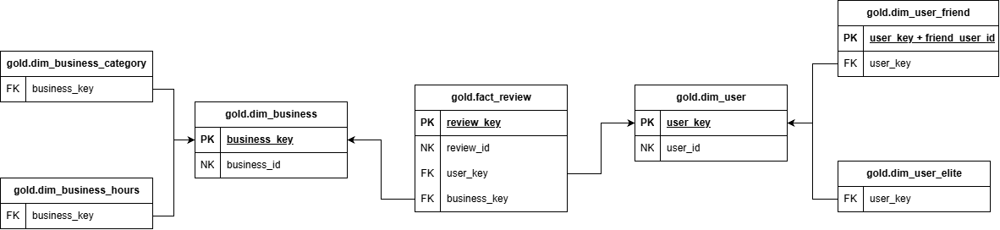

# Gold Layer Data Model & Business Rules

## 1. Snowflake Schema Overview

The Gold layer implements a **Snowflake Schema** centered on `gold.fact_review`, surrounded by two core dimensions (`gold.dim_user` and `gold.dim_business`) and four normalized 1:N sub-dimensions.

---

## 2. Table Dictionary & Grain

### `gold.dim_user`
- **Grain**: One row per Yelp user, plus one synthetic `UNKNOWN` member (`user_key = -1`).
- **Keys**: `PK`: `user_key` (surrogate `BIGINT`), `NK`: `user_id` (`TEXT`).
- **Attributes**: `name`, `yelping_since`, `review_count`, `average_stars`, `useful`, `funny`, `cool`, `fans`, and all `compliment_*` counters.

### `gold.dim_user_friend` (Snowflake Sub-Dimension)
- **Grain**: One row per unique `(user_key, friend_user_id)` friendship pair.
- **Keys**: `PK`: `(user_key, friend_user_id)`, `FK`: `user_key` $\rightarrow$ `gold.dim_user(user_key)`.
- **Transformation**: Splits the comma-separated `friends` field from `silver.yelp_user` using `string_to_array` + `unnest`, strips quotes/whitespace, and deduplicates pairs via `DISTINCT`.

### `gold.dim_user_elite` (Snowflake Sub-Dimension)
- **Grain**: One row per user and calendar year in which the user held Yelp Elite status.
- **Keys**: `PK`: `(user_key, elite_year)`, `FK`: `user_key` $\rightarrow$ `gold.dim_user(user_key)`.
- **Transformation**: Splits the comma-separated `elite` string, cleans quotes/spaces, casts to `INTEGER`, and deduplicates `(user_key, elite_year)`.

### `gold.dim_business`
- **Grain**: One row per Yelp business, plus one synthetic `UNKNOWN` member (`business_key = -1`).
- **Keys**: `PK`: `business_key` (surrogate `BIGINT`), `NK`: `business_id` (`TEXT`).
- **Attributes**: `name`, `address`, `city`, `state`, `postal_code`, `latitude`, `longitude`, `stars`, `review_count`, `is_open` (`BOOLEAN`).

### `gold.dim_business_category` (Snowflake Sub-Dimension)
- **Grain**: One row per `(business_key, category_name)` pair.
- **Keys**: `PK`: `(business_key, category_name)`, `FK`: `business_key` $\rightarrow$ `gold.dim_business(business_key)`.
- **Transformation**: Splits `categories` from `silver.yelp_business`, trims whitespace/quotes, and deduplicates via `DISTINCT`.

### `gold.dim_business_hours` (Snowflake Sub-Dimension)
- **Grain**: One row per open operating day `(business_key, day_number)` for a business.
- **Keys**: `PK`: `(business_key, day_number)`, `FK`: `business_key` $\rightarrow$ `gold.dim_business(business_key)`.
- **Columns**:
  - `day_number`: `1` (Monday) through `7` (Sunday).
  - `day_of_week`: Day name (`Monday`..`Sunday`).
  - `open_time` / `close_time`: `TIME` values parsed from `HH:MM-HH:MM`.
  - `closes_next_day`: `BOOLEAN` (`close_time < open_time`), identifying overnight shifts crossing midnight.
  - `is_24h`: `BOOLEAN` flag identifying 24-hour operating days.
  - `open_duration_hours`: `NUMERIC(4, 2)` total open hours for that day (adjusting `+24` hours when `closes_next_day = TRUE`).

### `gold.fact_review`
- **Grain**: One row per customer review.
- **Keys**: `PK`: `review_key` (surrogate), `NK`: `review_id`, `FK`: `user_key` $\rightarrow$ `gold.dim_user(user_key)`, `FK`: `business_key` $\rightarrow$ `gold.dim_business(business_key)`.
- **Measures & Attributes**: `stars`, `useful`, `funny`, `cool`, `text`, `date` (`DATE`).

---

## 3. Core Dimensional Business Rules

1. **Unknown Member Pattern (`-1`)**:
   - Both `dim_user` and `dim_business` insert a sentinel record with surrogate key `-1` and natural key `'UNKNOWN'`.
   - In `fact_review`, `LEFT JOIN` results are wrapped in `COALESCE(u.user_key, -1)` and `COALESCE(b.business_key, -1)` so orphan reviews never produce `NULL` foreign keys.
2. **Business Hours `0:0-0:0` Disambiguation Rule**:
   - In Yelp data, `0:0-0:0` represents either **24/7 operation** or a **closed/rest day**.
   - Using a window count (`zero_days`) per business:
     - If a business has **$\ge 5$ days** marked as `0:0-0:0`, those days are classified as **24-hour operation** (`is_24h = TRUE`, `open_duration_hours = 24.0`).
     - If a business has **$< 5$ days** marked as `0:0-0:0` alongside regular schedules, those isolated zero-days are treated as **closed days** and excluded from `dim_business_hours`.
3. **Indexing Strategy**:
   - Every materialized view defines a `UNIQUE INDEX` enforcing its primary/composite grain key, plus secondary B-tree indexes on foreign keys, natural keys, and high-cardinality filter columns (`date`, `day_number`, `category_name`, `elite_year`, `friend_user_id`).